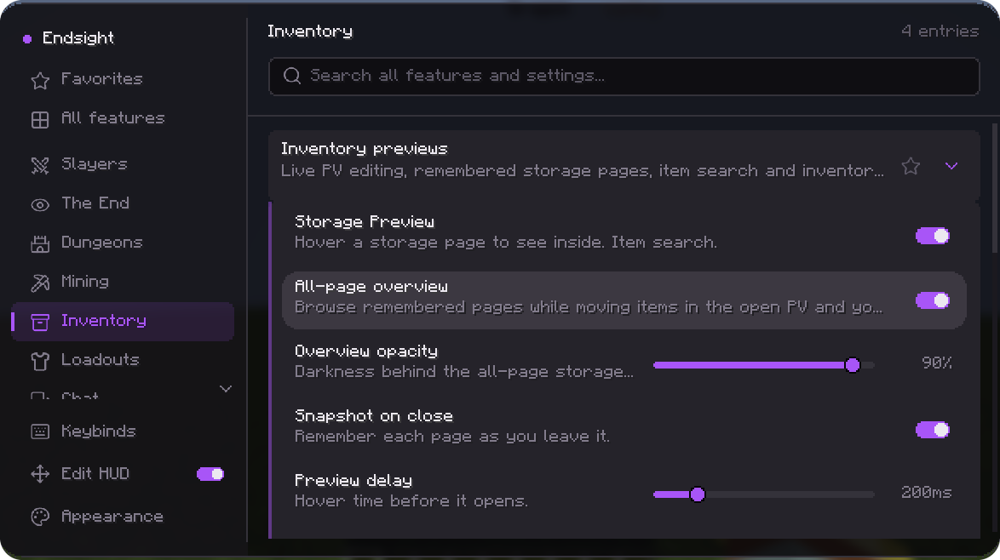
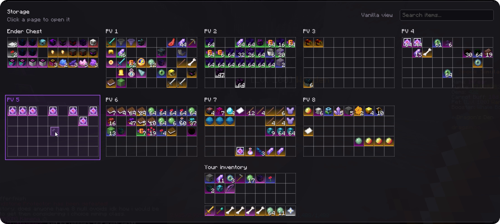
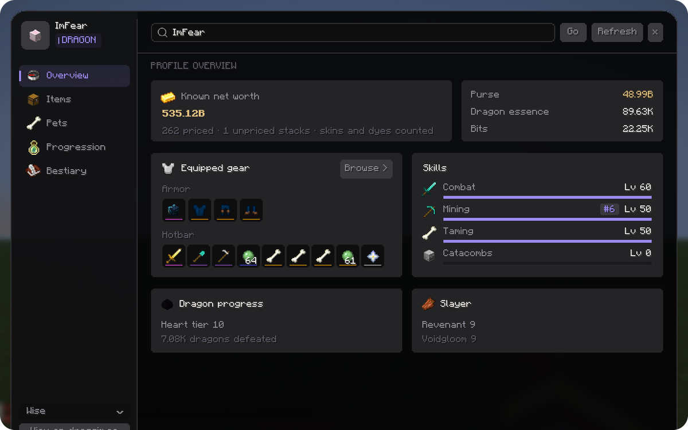
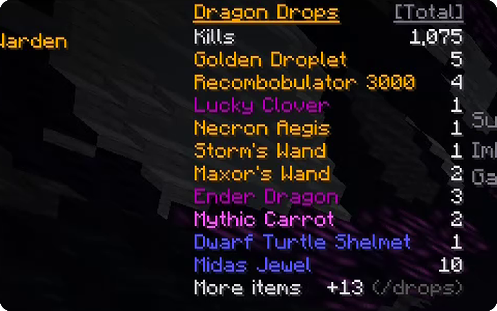
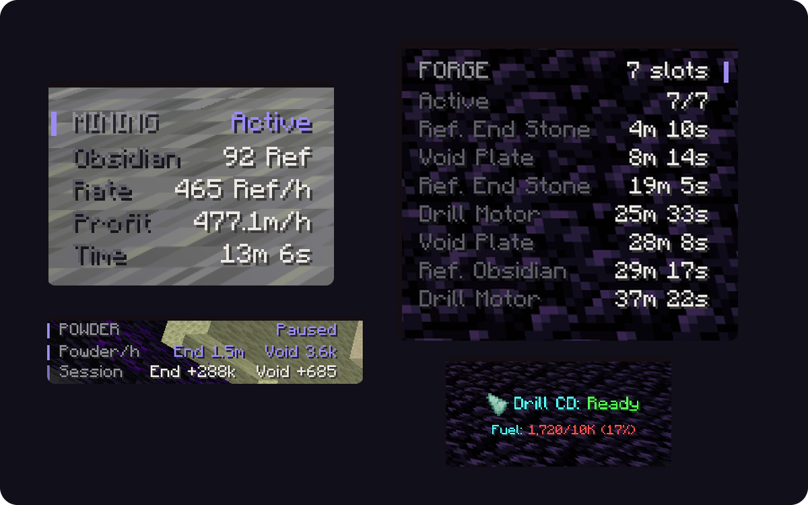
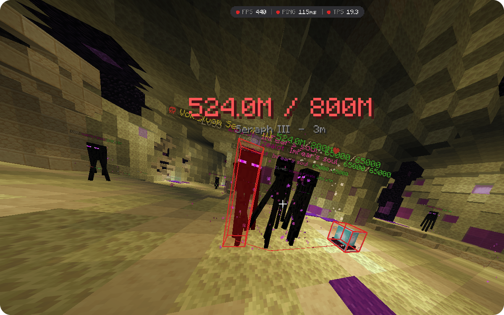
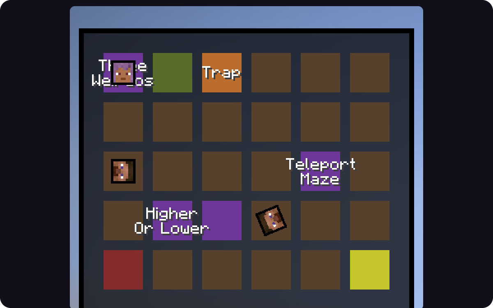
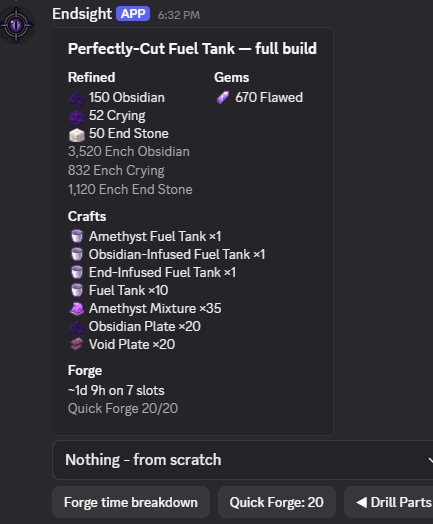

<h1 align="center">Endsight</h1>

  <b>Trackers, storage and dungeon tools for Dragsim, all in one clean menu.</b>

  
  
  
  

  

 

## Install

You need **Minecraft 26.1.2**, **Fabric Loader 0.19.1+**, **Fabric API** and **Java 25**.

1. Download one jar from the [latest release](https://github.com/RealZones/Endsight/releases/latest).
2. Put it in your `mods` folder next to Fabric API.
3. Join Dragsim and press **Right Shift** to open the menu.

| Jar | What it does |
|---|---|
| `endsight-autoupdate-<version>.jar` | Updates itself when you launch the game. |
| `endsight-<version>.jar` | Never updates itself. You download each new version. |

Endsight is on [Modrinth](https://modrinth.com/mod/endsight) too.

 

## A look inside

<h3 align="center">Every storage page on one screen</h3>

  Click an item on any page and it opens and picks that item up, shift click included.

  

 

<table>
  <tr>
    <td colspan="2" width="100%" valign="top">
      
      <h3>Profile viewer</h3>
      <code>/pv &lt;player&gt;</code> shows anyone's net worth, gear, pets, storage, progress and bestiary.
    </td>
  </tr>
  <tr>
    <td width="50%" valign="top">
      
      <h3>Boss Drops</h3>
      Every dragon, Warden and Protector drop you got, rarest first, for the session or all time.
    </td>
    <td width="50%" valign="top">
      
      <h3>Mining</h3>
      Profit an hour, live powder, Forge timers, and your drill's fuel and cooldown.
    </td>
  </tr>
  <tr>
    <td width="50%" valign="top">
      
      <h3>Voidgloom Helper</h3>
      Shield hits left, big on screen, with a box and tracer on your boss and the Yang Glyph.
    </td>
    <td width="50%" valign="top">
      
      <h3>Dungeons</h3>
      A live room map, key alerts, room puzzle solvers and terminal hints.
    </td>
  </tr>
</table>

 

## Everything it does

Click a section to open it.

<b>Slayers</b>

 

- **Slayer Tracker:** kills, average kill time, kills an hour, drops and profit.
- **Voidgloom Helper:** shield hits, boss health and phase cues.
- **Spawn markers:** where your boss will spawn, and the Revenant tiles in the Crypts.
- **Quest alert:** a popup and a link when you fight in a slayer area with no quest.

<b>The End</b>

 

- **Zealot Tracker:** kills and drops, with session profit and profit an hour.
- **Boss Drops:** your dragon, Warden and Protector loot. `/drops` prints it in chat.
- **Dragon tools:** dragon timer, dragon hitboxes and protection for placed eyes.
- **Boss indicators:** Golem stage, kills to its spawn, and beams over the Protector and Warden.
- **Goop boss:** countdowns to its next form, plus your fights, loot and profit an hour.
- **Cache Tracker:** Crypt Caches opened, every reward, and what each one made you.
- **End nodes:** an outline on confirmed shiny End nodes.
- **Golden Dragon math:** answers its sum for you.

<b>Dungeons</b>

 

- **Dungeon Map:** a live map of the rooms.
- **Key alerts:** tells you when a key drops.
- **Room puzzles:** Three Weirdos, Tic Tac Toe, Quiz, Higher or Lower and Ice Path.
- **Blood Room:** a timer on screen.
- **Terminal Solvers:** compact menu hints and Simon Says guidance.

<b>Mining</b>

 

- **Mining Session:** what you are mining, rate, profit and active time. Pauses when you stop.
- **Powder Tracker:** Ender and Void powder live, with session gain and perks you can afford.
- **Mining Spread:** reads your stat and learns the extra blocks you mine.
- **Forge Utils:** timers, ready slot outlines, recent crafts and missing materials.
- **Drill line:** ability cooldown and fuel, read off the drill in your hand.
- **Menu Buttons:** a Heart of the Dragon button in the Dragon Sim Menu.

<b>Inventory</b>

 

- **Storage:** every page on one screen, with search and live item moving.
- **Storage Preview:** hover a page to see inside it.
- **Recipes:** every recipe and Forge craft beside your inventory. **R** shows a recipe, **U** shows its uses.
- **Rarity Outlines:** rarity colour around every item, in menus and on the hotbar.
- **Glass Inventory:** see-through menus with an opacity control.
- **Item protection:** slot locking, and no armor swaps by accident.

<b>Chat</b>

 

- **Loot rolls:** your `/debug` rolls, compact, with close calls and real drops kept.
- **Ability Spam:** one cooldown line with a count, or none.
- **Goop cleanup:** hides Goop boss chat.
- **Copy Chat:** right click a line to copy it.
- **Global chat on join:** a lobby switch no longer leaves you in instance chat.

<b>General</b>

 

- **Alerts:** bosses, fireballs, full inventory, stash, Goop Bait and drops you care about.
- **Player HUD:** armor, pet, ability cooldowns, and FPS, ping and TPS.
- **Perspective Mode:** third person where the mouse moves the camera, not you.
- **World:** Fullbright and an explosion cloud hider.
- **Damage Numbers:** shorten them, keep crits only, or hide them.
- **Auto Clicker:** hold left click to repeat attacks at a varying rate.
- **Etherwarp Outline:** boxes the block you will land on.
- **Command Binds:** a key that sends a command, like `/warp end` on F6.
- **Discord Presence:** shows Dragsim, your name, area and purse on Discord.

 

## Make it yours

- **Keys:** bind any key or mouse button from the Keybinds page. Right click a key to clear it.
- **Prices:** set what any drop is worth, and every profit readout follows.
- **HUD:** click Edit HUD to drag any readout, or drag it straight from chat. Scroll over one to resize it.
- **Themes:** seven palettes, and everything follows the one you pick.
- **Search:** the search box finds any feature or setting.

| Command | What it does |
|---|---|
| `/endsight` or `/es` | Opens the menu |
| `/pv <player>` | Opens a profile |
| `/drops` | Prints your Boss Drops in chat |
| `/cache` | Prints your Crypt Caches in chat |

 

## Discord

<table>
  <tr>
    <td width="60%" valign="top">
      <b><a href="https://discord.gg/jSQDjqfZfV">Join the Discord</a></b> for help, updates and the Endsight bot.
        
      The bot does your forge maths: <code>/forge &lt;item&gt;</code> gives the whole build, from refined parts and gems to crafts and the time on your Quick Forge level.
        
      If the autoupdate jar fails, it shows a code from E1 to E7 in chat. Send that code in the Discord.
    </td>
    <td width="40%" valign="top">
      
    </td>
  </tr>
</table>

 

  Built by Fear · All rights reserved, see <a href="LICENSE">LICENSE</a>

